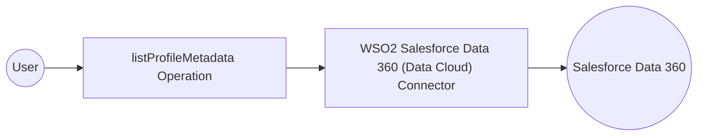

# Example

## What you'll build

Build an integration workflow that connects to Salesforce Data 360 (Data Cloud) and lists the profile data model objects of your org, with their fields and relationships. The workflow logs the result as JSON.

**Operations used:**
- **listProfileMetadata** : Reads the metadata of all profile data model objects, such as Individual and Contact Point Email

## Architecture

## Prerequisites

- A Salesforce org with Data 360 and an External Client App with the client credentials flow (see the [Setup Guide](setup-guide.md))

## Setting up the Salesforce Data 360 (Data Cloud) integration

> **New to WSO2 Integrator?** Follow the [Create a New Integration](product://integrator/develop-and-test/create-workspace) guide to set up your integration first, then return here to add the connector.

## Adding the WSO2 Salesforce Data 360 (Data Cloud) Connector

### Step 1: Open the connector palette and search for the connector

Select **Add Artifact**, then select **Connection** to open the connector palette. Search for `datacloud` and select the **Salesforce Data 360 (Data Cloud)** connector card.

## Configuring the Salesforce Data 360 (Data Cloud) connection

### Step 2: Fill in the connection parameters

Enter the connection parameters, binding each field to a configurable variable:

- **Config** : `ConnectionConfig` record with the client credentials of your External Client App; switch to **Expression** and enter `{auth: {clientId: datacloudClientId, clientSecret: datacloudClientSecret}}`
- **Service Url** : URL of your Salesforce org (its My Domain); bind to the `datacloudOrgUrl` configurable variable
- **Connection Name** : Keep the default `datacloudClient`

### Step 3: Save the connection

Select **Save Connection**. The connection appears under **Connections** in the project tree and on the design canvas.

### Step 4: Set actual values for your configurables

1. In the left panel, select **Configurations**.
2. Set a value for each configurable listed below:

- **datacloudOrgUrl** (string) : The My Domain URL of your Salesforce org, for example, `https://acme.my.salesforce.com`
- **datacloudClientId** (string) : The consumer key of your External Client App
- **datacloudClientSecret** (string) : The consumer secret of your External Client App

## Configuring the Salesforce Data 360 (Data Cloud) listProfileMetadata operation

### Step 5: Add an automation entry point

Select **Add Artifact**, then select **Automation** and select **Create** to add the automation entry point to the canvas.

### Step 6: Select and configure the listProfileMetadata operation

1. On the automation canvas, select the **+** button to add a step.
2. Expand the **datacloudClient** connection under **Connections**.
3. Select **List Profile Metadata** (`listProfileMetadata`) and set the result variable name to `result`. The operation takes no parameters.
4. Select **Save** to add the operation to the flow, then add a **Log Info** step after it that logs `result.toJsonString()` in **Expression** mode.

## More code examples

The WSO2 Salesforce Data 360 (Data Cloud) Connector provides practical examples illustrating usage in various scenarios. Explore these [examples](https://github.com/ballerina-platform/module-ballerinax-salesforce.datacloud/tree/main/examples), covering use cases like bulk customer loads and customer profile lookups.

1. [Bulk customer load](https://github.com/ballerina-platform/module-ballerinax-salesforce.datacloud/tree/main/examples/bulk-customer-load) - Create a bulk upsert job, upload a CSV file to it, close it, poll it until processing finishes, and delete the finished job.

2. [Customer profile insights](https://github.com/ballerina-platform/module-ballerinax-salesforce.datacloud/tree/main/examples/customer-profile-insights) - Validate and stream a customer record, start an identity resolution run, and find the customer by email to read their profile and calculated insight values.
